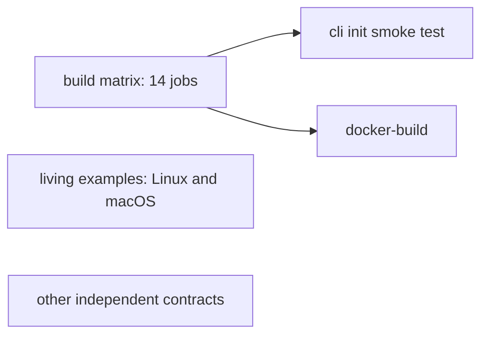
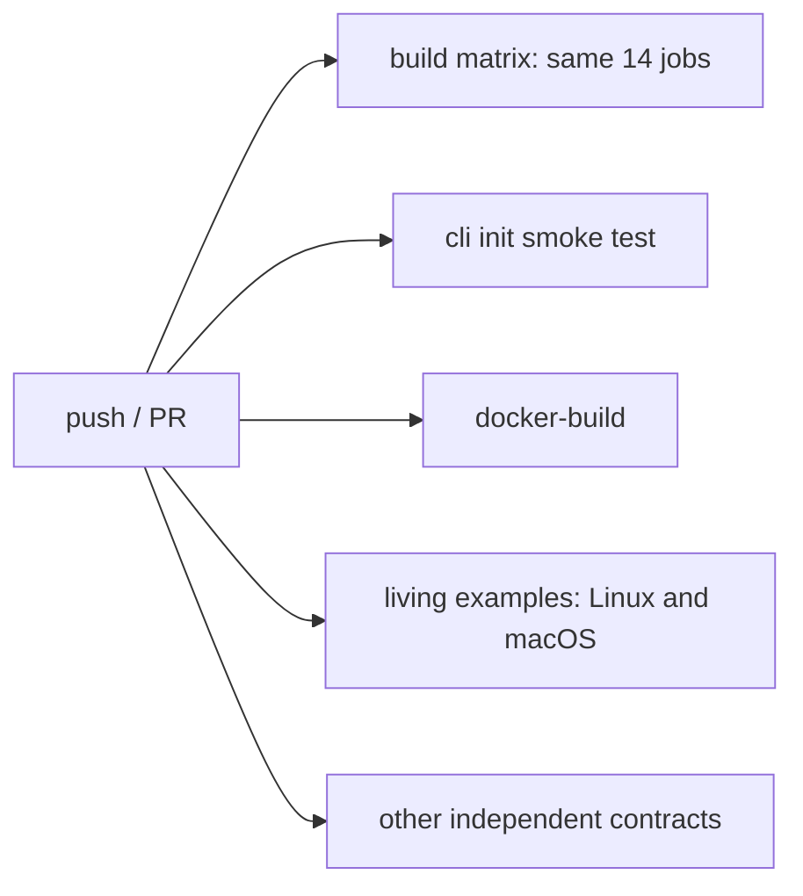

# CI performance investigation

Baseline: `257c33d38c693b73127d5287806867d3d082c7cd`. Zig 0.17.0.
No runtime, application API, existing test cases or release workflows are changed.

## Measurements and reproducibility

[Collected job/step and living-example command timings](measurements.md) include
four successful runs (reference 42009937630 and recent 42172173403, 42180983015,
42181682857). Raw API timestamps, exact SHAs and original JSON artifacts are in
[raw](raw/). Results vary substantially across hosted runners; compare medians
and separate queue time, execution time and cache restore/save overhead.

```sh
python3 tools/ci/measure.py collect 42009937630 42172173403 42180983015 42181682857
python3 tools/ci/measure.py report
# After pushing a change, collect its run ID using the same commands.
gh run list --repo moribit/Akamata --workflow ci.yml
# Re-run the same workflow via workflow_dispatch to compare warm caching.
gh workflow run ci.yml --repo moribit/Akamata --ref main
```

The collector uses read-only GitHub APIs and artifact downloads. Run wall time
is creation to last job completion (includes runner queues); total job time is
the sum of elapsed job durations, not billing-adjusted macOS minutes. Step times
are API timestamps with second precision. Test assertions inside a build are not
attributed to compilation unless independently measured.

## Confirmed baseline costs

- 23 jobs; four-run median wall **1,076.5 s**, job sum **5,415 s**.
- Latest baseline: CLI starts **703 s** after run creation; its own execution is
  **529 s**. `scaffold-local-test` takes **302 s**, initial CLI compilation 129 s.
- Living examples spend about **98–99%** of their command time in `zig build`.
  This includes compilation and test execution; it is not a pure compiler CPU
  profile. Four ReleaseSafe executables and Debug/ReleaseSafe test compilation
  dominate. WASM hosts and TS/schema checks are comparatively small.
- `use-cache: false` disables compilation caching, **not** Zig toolchain tarball
  caching. The pinned setup-zig action still caches compiler downloads.
- A cold/warm local guestbook ReleaseSafe probe: compile **15 s → cached 40 ms**;
  tests **394 ms → 2 ms**, **2/2 actually run** in both. These are local diagnostics,
  not predicted hosted-runner savings.

## Dependency graph

Before (the build node expands to 14 independent jobs):



After:



Neither downstream job downloads build-matrix artifacts. Both independently
checkout, fetch SQLite and compile their own binaries, so there is no data or
safety dependency on the other 14 results. All checks must still pass. Independent
CLI/container checks now run even when another matrix job fails: earlier feedback
costs some additional runner time on failed pushes. An external system that treated
only the CLI check as an umbrella must instead inspect the complete workflow;
no such branch-required-check configuration was present in the audited repository.

## Cache pilot and test execution safety

Pilot compilation caches are isolated by job/matrix name, OS/architecture and
Zig version. Pinned setup-zig restores `.zig-cache` and points both Zig caches
there. Each cache is limited to 2 GiB uncompressed; the action clears rather than
saves an oversized cache. Restore/save logs and compressed repository-cache sizes
must be checked before expanding the pilot. PR caches remain subject to GitHub's
branch-scope rules; no privileged pull_request_target workflow is introduced.

Zig 0.17 can cache successful test **execution**, as confirmed in its installed
`lib/compiler/Maker/Step/Run.zig`. `AKAMATA_CI_RERUN_TESTS=1` marks all reachable
`.zig_test` run steps as side-effecting in this repository's build graph. Compile
outputs remain cacheable, while every unit/integration test still executes.
Generated scaffold projects use fresh temporary directories and their existing
checks are retained. Warm test summaries are collected to verify this behavior.

Living-example command evidence is now written after every command, including
failure. CLI scaffold timing uses separate notes/minimal JSONL files, preserving
stdout/stderr and exit status; artifacts upload with `if: always()`.

## PR fast lane versus full verification

Keep the **same full suite for PR and main** in this iteration. There are no path
filters, skipped OSes, reduced optimization modes, renamed checks or removed test
cases. Native Debug/ReleaseSafe, OpenSSL, Linux/macOS transport contracts, both
living-example OSes, Workers hosts, generated client checks, CLI/scaffold/update
and container builds remain required by the workflow's success result.

A read-only API audit on 2026-11-06 reports main `Branch not protected` (404) and
repository rulesets `[]`. No repository settings were changed. Preserving check
names also avoids breaking consumers that reference them outside those settings.
Splitting a reduced PR suite from main-only full validation would delay failure
detection and require an explicit merge/release policy. First remove avoidable
waiting and compiler rebuilds; evaluate a split only if measured cold latency
remains unacceptable. Release approval must still inspect the complete candidate
CI and separate Linux/macOS TSan workflow; neither is weakened here.

## Results

### Dependency-only benefit and first cache experiment

| Configuration | Wall | Total job time | Outcome |
|---|---:|---:|---|
| Baseline, four-run median | 1,076.5 s | 5,415 s | 23/23 each |
| Independent jobs + initial cache fill, 42186696270 | 651 s | 5,316 s | 23/23 |
| Initial warm cache, 42187971389 | 638 s | 5,447 s | 23/23 |

The **40.7%** wall reduction versus the baseline median is observed, not a
controlled causal estimate of cache effectiveness. Most of this is explained by
removing the build-matrix barrier; total job execution has not fallen materially.
Do not advertise the initial cache policy as a general compiler speedup.

In the first warm run, OpenSSL test compilation/execution grew from 408 to 543 s;
CLI compilation grew from 94 to 114 s, while living-example Linux Debug tests
fell from 75.224 to 7.488 s. ReleaseSafe rebuilds remain dominant. All four cache
lookups hit, but the CLI cache grew to **2,678,315,516 bytes** and was cleared by
the pinned action's 2 GiB limit. A cache hit alone is not an optimization result.

The action normally extracts Zig to a fresh temporary installation directory.
A second controlled experiment fixes the tool installation path using the
pinned action's `use-tool-cache: true`, with a separate v2 cache namespace.
The same SHA (`1e18bab`) was tested once via push and once via dispatch.
Results below show that a stable installation path was **not sufficient** to
produce a material whole-workflow improvement. The exact remaining compiler
cache-miss cause is **unknown**; this report does not present that hypothesis as
an established root cause.

### Scaffold decomposition

First hosted instrumented run: notes commands total **116.98 s**, minimal
commands **106.60 s**, versus enclosing scaffold step **224 s**. Notes
ReleaseSafe executable compilation accounts for 77.22 s; minimal executable
and test compilation/execution account for 55.50 + 49.23 s. Migration/tooling
checks themselves are small; reducing assertions would not address this cost.
The two suites are also serialized: their measured sums (223.58 s) nearly equal
the enclosing 224 s step. Zig 0.17 `std/Build/Step/Run.zig` documents the global
execution lock for inherited stdio; these system commands use that behavior.
Parallelizing them would require checked/captured stdio, preserved failure logs
and a memory/CPU-contention measurement. It is recorded as a candidate, not
silently enabled: CLI is no longer the measured global critical path.
Local notes/minimal diagnostics and a reproducible fresh/warm local test probe
are saved in `raw/local`. Run `python3 tools/ci/local_probe.py` to repeat it.

The probe measures **47.710 s → 0.227 s**, with **2/2 tests actually executed**
both times. The fresh probe's test body takes 273 ms (about 0.6% of the
47.710 s total); test compilation takes 34 s plus supporting compile/configuration
work. Warm test execution is 3 ms and compilation is cached (47 ms lookup).
These nested build times must not be summed as independent CPU costs.
Only the local cache starts fresh; installed tools and global
package caches are retained. It is not a whole-machine cold build.

An instrumentation issue was also found: storing JSONL timing under the restored
compiler cache accumulates prior-run rows. Original pilot artifacts are retained
unchanged; their warm JSONL must not be summed without removing the previous
prefix. Final timing lives outside `.zig-cache` so each artifact contains only
its own run. This affects diagnostic accounting, not test execution.

### Coverage and policy

- All 14 matrix entries and all 57 original living-example commands are retained.
- Both OSes still compile Debug/ReleaseSafe examples, run Native application and
  migration checks, validate endpoint/capability metadata, generate OpenAPI/TS/C
  clients and execute actual Workers artifacts with the JSPI host fixture.
- The first warm OpenSSL job reports **203/203 tests passed**; living examples
  report **13/13** in each optimization mode and **15/15** documentation tests.
  Summaries explicitly show `run test ... pass`, rather than cached verdicts.
- Added diagnostic failure-path tests cover nonzero return status, checked
  subprocess failures and partial living-example evidence after failure.
- Full-suite pushes/PRs and separate sanitizer workflows remain unchanged in
  scope; no automatic retry or continue-on-error is introduced.
- No new flaky failure has been observed in these two complete changed runs.
  This is a limited observation, not a proof that the suite is flake-free.


### Stable-toolchain cold/warm comparison and decision

| Metric | Initial fill 42232703639 | Same-SHA warm 42234525201 | Change |
|---|---:|---:|---:|
| Whole workflow | 715 s | 700 s | −2.1% |
| Total elapsed job time | 5,558 s | 5,442 s | −2.1% |
| Linux living examples | 647 s | 695 s | +7.4% |
| macOS living examples | 685 s | 626 s | −8.6% |
| OpenSSL | 481 s | 378 s | −21.4% |
| CLI smoke | 521 s | 388 s | −25.5% |
| Compilation cache lookup hits | 0/4 | 4/4 | all restored |

Both runs passed **23/23** jobs. The warm run restored all four caches but Linux
living-example compilation remained the critical path. Individual job changes
are mixed, and the small overall difference is not distinguishable from the
hosted-runner variation in the baseline. Different run events and runner queues
also limit causal interpretation even though source SHA and workload match.

Uncompressed warm sizes: Linux living **1,924,578,592 B**, macOS living
**585,942,803 B**, OpenSSL **1,357,952,501 B**, CLI **2,124,600,110 B**. CLI is
already at 99% of its 2 GiB cap. Compressed saved snapshots are approximately
170–348 MB each; exact entries and timestamps are in the raw cache inventory.
Inventory files reflect repository state **at collection**, not a historical
snapshot at job start; per-job restore/save logs identify the measured cache.

**Decision: revert both compilation-cache policies.** Final setup keeps
`use-cache: false`; toolchain tarball download caching remains as before. No
capacity increase, global pool, CPU-baseline change or reduced test coverage is
introduced to make the cache experiment look successful. Revisit caching only
with compiler cache-miss attribution, repeatable benefits and a bounded retention
strategy. All trial data and commits are retained for that investigation.

Keep the proven independent scheduling, workflow_dispatch, actual-test-execution
safeguard, command timing, partial failure evidence and artifact isolation.

## Final adopted configuration — all gates passed

Code commit: `9e2b233648f6ddde05544cf1a50e216c51bc5fe7`.
[Final full CI 42236457517](https://github.com/moribit/Akamata/actions/runs/42236457517)
passes **23/23**, including Linux/macOS runtime contracts, Workers builds/host
fixtures, strict TS checks, CLI/scaffold/update/sync and container validation.
No job retries or newly observed flaky failures occurred across the five
complete changed-workflow runs recorded here. This is finite-run evidence.

| Metric | Before | Final | Difference |
|---|---:|---:|---:|
| Workflow wall, baseline four-run median | 1,076.5 s (17:56.5) | 683 s (11:23) | **−36.6%** |
| Sum of job durations | 5,415 s (90:15) | 5,550 s (92:30) | +2.5% |
| Jobs passed per workflow | 23/23 | 23/23 | unchanged |
| Original living-example commands per OS | 57 | 57 | unchanged |
| Compiler cache policy | disabled | disabled after trials | no storage dependence |
| CLI start offset, latest baseline versus final | 703 s | 4 s | barrier removed |
| Docker start offset, latest baseline versus final | 703 s | 4 s | barrier removed |

Final job durations: Linux living **554 s**, macOS living **678 s**, OpenSSL
**391 s**, CLI smoke **428 s**, container **150 s**. Runner performance varies;
these individual changes do not demonstrate faster compilation from the final
policy. The main benefit is earlier feedback through independent scheduling,
**not reduced total compute cost**. Mac living examples remain the critical path.

Final living artifacts retain 8 Native and 4 Workers build-artifact identities
per OS and all 57 original commands. Test summaries show both 13-test example
suites and the 15-test documentation suite actually executing. OpenSSL reports
203/203 passing tests. The additional three Python diagnostic tests also pass.
The final CLI artifact contains this run's notes/minimal commands only; runtime
stress artifacts for both OSes remain available. Reports are outside the restored
compiler cache and upload even on failure.

The follow-up evidence/documentation commit contains these results; its source
code is unchanged from the validated code commit above. Reproduction commands
and all comparison SHAs, job/step times, cache observations and downloaded JSON
artifacts are included in this directory.

Validation events in this report are push and workflow_dispatch. A separate live
pull-request event was not created; PR uses the same jobs and conditions, with no
new event-dependent skipping. Separate TSan workflows were preserved, not rerun
for this CI-only change.

## Remaining bottlenecks / next work

1. Living-example Native ReleaseSafe compilation remains expensive. Duplicate
   matrix coverage is documented, but executable artifacts are also run for
   migration/schema/protocol/host contracts; simply deleting those builds would
   leave the script without its tested inputs. No OS or optimization coverage
   was removed.
2. Use compile-step summaries to attribute cache misses (compiler/SDK paths,
   native target identity and generated inputs), rather than retrying blind
   cache policy changes. Dedicated-runner evidence may reduce CPU variance.
3. If a shorter cold critical path is necessary, evaluate sharding compilation
   while retaining an explicit all-shards-success check. Account for additional
   runner startup, queue contention, cache storage and total execution cost.
4. Main currently has no branch protection/ruleset gate. This task preserves
   workflow coverage but does not configure repository policy or weaken release
   approval/sanitizer requirements.
